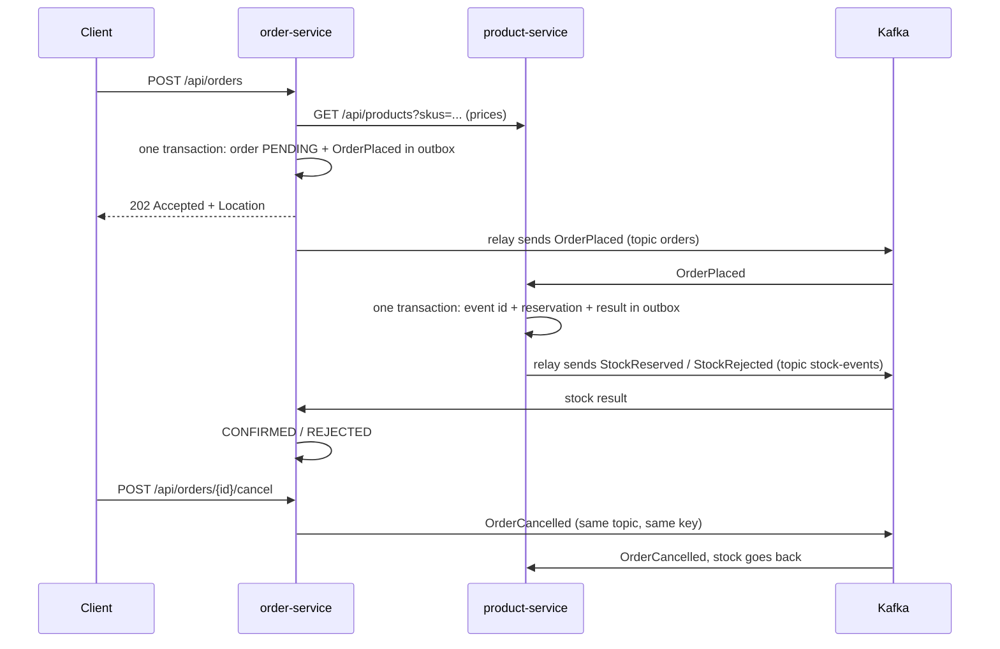

# shop-backend

Order checkout for an online shop, split into two Spring Boot services. `order-service` takes orders and
tracks their status. `product-service` owns products, prices and stock, and reserves stock for orders. Each
service has its own database and never reads the other one's tables. They talk over HTTP for one read-only
call and over Kafka for everything that changes state. Events are Avro records checked against a Schema
Registry, and every event goes through a transactional outbox, so a crash cannot lose it.

## How it works



1. `POST /api/orders` is validated (at least one line, quantity > 0).
2. order-service asks product-service for prices of all SKUs in one call. Unknown or inactive SKUs give `422`
   with the list of them.
3. The order is saved as `PENDING` with the prices fixed at that moment. `OrderPlaced` is written to the
   `outbox` table in the same transaction. The client gets `202`: the order is accepted, not confirmed yet.
4. A relay inside order-service reads the outbox every 200 ms and sends new events to Kafka.
5. product-service reserves stock for every line or for none, and writes `StockReserved` or `StockRejected`
   (with the SKUs that ran out) to its own outbox.
6. order-service moves the order to `CONFIRMED` or `REJECTED`.
7. `POST /api/orders/{id}/cancel` moves a pending or confirmed order to `CANCELLED` and publishes
   `OrderCancelled`. product-service puts the reserved stock back.

`GET /api/orders/{id}` returns one order, `GET /api/orders?page=0&size=20` the newest orders with their lines.

## Design decisions

### Transactional outbox

A Postgres transaction cannot include a Kafka send. In v1 the event was sent after commit, and a crash between
the two left the order `PENDING` forever. Now the event is a row in the `outbox` table, written in the same
transaction as the business change, so a saved order always has its event saved too. `OutboxWriter.append`
is `@Transactional(propagation = MANDATORY)`: called without a transaction it throws instead of quietly
committing the event on its own.

`OutboxRelay` runs every 200 ms in one transaction: take `pg_try_advisory_xact_lock`, read up to 100 unsent
rows ordered by `seq`, send them, wait for Kafka to acknowledge, set `published_at`, commit. If Kafka does not
answer within 10 s, the transaction rolls back and the rows stay unsent. The pause after a failed attempt
doubles up to 5 s, so a dead broker does not flood the log.

The advisory lock means only one copy of a service sends at a time. With two order-service pods both sending,
`OrderPlaced` and `OrderCancelled` of one order could leave from different pods and swap places.
`FOR UPDATE SKIP LOCKED` would split rows between copies and break that order in the same way. When the
sending pod dies, its connection closes, the lock is released and the other pod takes over. The price is that
one pod does all the sending, which is far more than this load needs.

Rows are ordered by `seq` (a sequence), not `created_at`: timestamps can be equal or jump. Events of one order
are written in separate transactions, one after the other commits, so their `seq` follows the order of events.

Sent rows are kept for 3 days for debugging and then deleted by a daily job. The outbox code is shared by both
services in the `messaging-support` module.

Debezium would read the same table from the Postgres WAL, without polling and with less delay, but it means
running Kafka Connect. For two services polling is simpler, and switching later does not change the services.
See [docs/outbox.md](docs/outbox.md).

### Idempotent consumers

The outbox sends at least once: if the relay sends a batch and dies before marking it, the batch goes again. So
duplicates are normal. Every event carries a stable `eventId` (the outbox row id) in a Kafka header. A
consumer handles an event in one transaction: `INSERT INTO processed_events ... ON CONFLICT DO NOTHING`, and
if no row was inserted the event is a duplicate and is skipped. Otherwise the business change and the outgoing
event are written in the same transaction. A `SELECT` first and an insert later would let two deliveries of
the same event (for example during a rebalance) both pass the check; the primary key does not.

Event ids are kept for 14 days, longer than the 7 days a record lives in a topic, so a duplicate cannot arrive
after its id is forgotten. Status rules stay as a second line of defence: an order changes status only from
the states that allow it. See [docs/idempotency.md](docs/idempotency.md).

### Cancellation as a compensating step

The flow is a choreographed saga: each service reacts to the other's events, nothing coordinates them.
Cancellation adds a compensation, an action that undoes an earlier step.

- `PENDING` or `CONFIRMED` → `CANCELLED` and `OrderCancelled`; an already cancelled order → `200` without a
  new event; `REJECTED` → `409`.
- `OrderCancelled` goes to the `orders` topic with the `orderId` key, the same as `OrderPlaced`, so
  product-service always sees it after `OrderPlaced` of the same order.
- product-service returns stock only for a `RESERVED` reservation and marks it `RELEASED`. A rejected or
  unknown order needs nothing.
- No event comes back: the order is already `CANCELLED`, and an event nobody reads is a contract to maintain
  for nothing.

An orchestrator would earn its place with three or more steps and branches (payment, delivery). With two
participants it is an extra moving part. See [docs/sagas.md](docs/sagas.md) and [docs/cqrs.md](docs/cqrs.md)
for why there is no separate read model either.

### Optimistic locking on orders

A client can cancel at the same moment as `StockReserved` arrives. Both read `PENDING`; without protection the
second write wins and the order could end up `CONFIRMED` after `OrderCancelled` was sent and the stock
returned. `Order` has a `@Version` column, so the second commit fails. In the API this is `409` ("reload and
try again"). In the listener it is a normal retryable error: the retry reads the order again, sees
`CANCELLED` and does nothing. `CancelOrderServiceTest` holds a cancel open inside its transaction, confirms
the order meanwhile, and checks that the cancel fails and no `OrderCancelled` is written.

Stock uses a different tool, a conditional `UPDATE`, because it is a counter changed by one statement. Order
status has rules that live in the `Order` class, and `@Version` keeps them there instead of moving them into
SQL. Isolation stays at Postgres's default `READ COMMITTED`: the races are already closed by the conditional
updates, `@Version` and primary keys. See [docs/database.md](docs/database.md).

### Reservation is one conditional UPDATE per line

`UPDATE stock SET available = available - :qty WHERE sku = :sku AND available >= :qty` checks and writes in
one statement, so two orders cannot both take the last unit. If some line is short, the whole attempt rolls
back, together with its `processed_events` row, and the rejection is stored in a second transaction with the
event id and `StockRejected` in the outbox. Only one of the two transactions commits, so an event still has one
outcome, and the database undoes the stock taken for the other lines. Lines are processed in SKU order so two
orders always lock rows in the same order and cannot deadlock. `CHECK (available >= 0)` is the last line of
defence.

### Event contracts: Avro and Schema Registry

Schemas are `.avsc` files in the `contracts` module, and `avro-maven-plugin` generates the Java classes during
the build. The producer registers the schema in Schema Registry and each message carries only the schema id.
The registry rejects a new version that old readers cannot handle.

- Compatibility is `BACKWARD` (the default): a new schema must read data written with the previous one. A
  field can be added with a default or removed; a required field cannot be added. Consumers upgrade first.
- `orders` carries two event types. Splitting them into two topics would lose the order of events of one
  order, so the subject name strategy is `TopicRecordNameStrategy`: one subject per topic and type, for
  example `orders-com.shop.contracts.OrderPlaced`.
- `eventId` and `eventType` are Kafka headers, not fields, so the duplicate check, the DLT and tracing work
  without reading the payload.
- Money is the Avro `decimal` logical type (precision 12, scale 2), like the database column.
- The outbox stores the event in Avro's JSON encoding, and the relay turns it into binary and registers the
  schema. Taking orders does not depend on the registry being up, and the outbox rows are readable.
- `OrderPlaced` already went through one change: `currency` was added with the default `"EUR"`.
  `SchemaCompatibilityTest` registers the first version, checks that the current schema is accepted on top of
  it, and that a new required field is rejected with `409`.

Confluent classes are only named in `application.yml`; the code depends on the generated classes and on
Avro's `SpecificRecord`. See [docs/contracts.md](docs/contracts.md).

### HTTP only for reading prices, Kafka for changing state

The price is needed to create the order at all, and reading is safe to repeat, so it is a synchronous call.
Reserving stock changes another service's data, so it goes through Kafka: the order is accepted even if
product-service is down, and the reservation happens when it comes back.

### Topics, keys and partitions

`orders` and `stock-events` have 3 partitions each and are keyed by `orderId`, so all events of one order land
in the same partition and are handled in order, while different orders are handled in parallel. The service
that writes a topic creates it with a `NewTopic` bean; auto-creation is off in the broker. The topics are a
history of events and are cleaned up by time, not compacted; see [docs/kafka.md](docs/kafka.md).

### Errors in consumers

- A business outcome is not an error: not enough stock is a normal `StockRejected`.
- A temporary error (the database is down, a version conflict) gets 4 retries with exponential backoff (1, 2,
  4, 4 s), then the DLT.
- A permanent error goes to the DLT at once: a record that is not valid Avro or has an unknown schema
  (`ErrorHandlingDeserializer`), an unknown SKU, an event type the listener does not expect.

`DefaultErrorHandler` with `DeadLetterPublishingRecoverer` writes to `orders-dlt` / `stock-events-dlt` with
headers for the cause, original topic, partition and offset. Unreadable records are copied byte for byte.

### Paging without N+1

`GET /api/orders?page=0&size=20` returns orders with their lines. Loading lines for each order separately
would be 1 + 20 queries. `join fetch` together with a limit makes Hibernate read all rows and paginate in
memory. So the page is two queries: ids of the page first, then those orders with their lines (`where id in
(:ids)` with `join fetch`). `OrderPageQueryTest` counts statements with Hibernate statistics: 2 for a page of
5 and for a page of 20. A naive version gave 7 for the page of 5.

### Observability

The question to answer quickly is "where is this order and why is it still `PENDING`".

- Metrics on `/actuator/prometheus`: `outbox_pending` (events waiting to be sent; growing means Kafka or the
  relay has a problem), `outbox_publish_failures_total`, `events_duplicates_total`, plus the standard HTTP,
  JVM, connection pool, Resilience4j and Kafka client metrics, including
  `kafka_consumer_fetch_manager_records_lag_max`.
- Tracing with Micrometer Tracing and OpenTelemetry, exported over OTLP to Jaeger. Spring passes
  `traceparent` through HTTP and Kafka headers itself. The outbox would cut the trace in two, because the relay
  sends later from its own thread. So `OutboxWriter` saves the current `traceparent` in the `headers` column
  and the relay continues that trace. In Jaeger one order is one trace: `POST /api/orders` → price lookup →
  outbox send → `orders` → product-service → `stock-events` → status update.
- Every log line has the trace id. There is no separate correlation id; it would be a second name for the same
  thing. Logs are JSON (ECS) in the `k8s` profile and plain text locally.

See [docs/observability.md](docs/observability.md).

### Kubernetes

- The image is a multi-stage build: Maven in a JDK image, then only the JRE. The jar is extracted into layers,
  so a code change rebuilds a 165 kB layer and the 102 MB of dependencies stay cached. It runs as user 1001
  with `-XX:MaxRAMPercentage=75`, so the heap follows the container memory limit.
- Probes use Actuator health groups. Startup checks liveness up to 30 times every 5 s, so a slow JVM start is
  not a failure. Liveness checks only the process: restarting does not fix a broken dependency, and putting
  the database there would restart every pod when the database goes down. Readiness checks the process and the
  database. Kafka is left out on purpose: thanks to the outbox, orders are accepted without it.
- Graceful shutdown: on SIGTERM the pod is removed from the Service, but that spreads with a delay, so
  `preStop` sleeps 5 s. Then Spring waits up to 20 s for running requests, the listeners stop and commit, and
  the relay finishes its batch. `terminationGracePeriodSeconds: 30` covers both.
- `RollingUpdate` with `maxUnavailable: 0`, `maxSurge: 1`: a new pod is ready before an old one stops. A
  `kubectl rollout restart` of order-service during a steady stream of requests finished without a failed
  request.
- Requests are 512Mi memory and 250m CPU, the memory limit 768Mi. There is no CPU limit: the JVM needs a burst
  of CPU at startup and throttling would stretch it. The pods run as non-root with a read-only root
  filesystem and an `emptyDir` on `/tmp`.
- Addresses and the profile are in a ConfigMap, the database password in a Secret, so one image runs anywhere.
- Kustomize (`kubectl apply -k k8s/`) is built into kubectl; Helm templating would be overkill for two
  services.

Jaeger runs only in docker compose. In the cluster only the OTLP exporter is switched off
(`management.tracing.export.otlp.enabled=false`), so trace ids still pass between services and show up in the
logs. Switching off `management.tracing.export.enabled` would also switch off propagation. See
[docs/kubernetes.md](docs/kubernetes.md).

### Resilience4j on the price call

| Layer | Settings | What it is for |
|---|---|---|
| HTTP client timeouts | connect 1 s, read 2 s | a hanging catalog does not hold our thread forever |
| Retry | 3 attempts, 200 ms × 2 with jitter, only network errors and 5xx | short blips such as a restart; 4xx will not change on retry |
| Circuit breaker | window of 20 calls, at least 10, opens at 50% failures or slow calls (> 1.5 s), 10 s open, 3 trial calls | when the catalog is down, answer at once instead of waiting for timeouts |
| Bulkhead | 20 concurrent calls, no waiting | a slow catalog cannot take all request threads |
| Rate limiter | 50 orders per second on `POST /api/orders` → `429` | a burst does not overload us and the catalog |

The aspects wrap in Spring Boot's default order: Retry → CircuitBreaker → Bulkhead → call. The fallback sits on
the retry and turns the final error into `503` with `Retry-After: 10`.

The HTTP client is pinned to the JDK one (`spring.http.clients.imperative.factory: jdk`). The Schema Registry
client brings Apache HttpClient, which Boot would pick instead, and it retries `503` on its own under our
retry: the catalog got 6 calls instead of 3. See [docs/resilience4j.md](docs/resilience4j.md).

### Code layout

Maven modules:
- `contracts`: Avro schemas and the generated classes;
- `messaging-support`: outbox writer, relay and cleanup, `processed_events`, metrics, plugged in as a Spring
  Boot auto-configuration. The outbox and the duplicate check are the same in both services and contain no
  business logic, so they are written once; domain code stays in each service;
- `order-service`, `product-service`.

Inside the services: packages by feature, layers inside. `ProductCatalog` and `OrderEvents` are ports in
`domain`; `OrderEvents` was introduced in v1 and the switch to the outbox only replaced its implementation
(`KafkaOrderEvents` → `OutboxOrderEvents`). Status transitions live in `Order` (`confirm()`, `reject()`,
`cancel()`).

## Failure handling

| What happens | Result |
|---|---|
| order-service dies right after the commit | the event is already in the outbox; the relay sends it after the restart |
| Kafka is down | orders are still accepted (`202`), `outbox_pending` grows; when Kafka is back the events go out in order |
| the relay sends a batch and dies before marking it | the batch goes again; consumers skip it by `eventId` |
| the pod that was sending dies | its advisory lock is released, the other pod takes over |
| cancel and stock result at the same time | one of them hits a version conflict: the API answers `409`, the listener retries and sees the current state |
| incompatible schema change | `SchemaCompatibilityTest` fails in the build; the registry would refuse the schema |
| unreadable record or unknown schema | DLT, the next records are processed |
| product-service is down | 3 attempts per request, then `503`; after enough failures the circuit opens and `503` comes back in a few ms |
| not enough stock | `StockRejected`, order `REJECTED`, stock unchanged |
| the database is down in the cluster | readiness fails, the pod leaves the Service but is not restarted; it comes back when the database does |
| a pod is deleted or rolled | running requests finish, new ones go to other pods |

## Limitations

- One Kafka broker with replication factor 1: losing it loses data. Production would run 3 brokers with
  `min.insync.replicas=2`.
- No authentication or TLS, neither in Kafka nor between the services.
- No autoscaling (HPA).
- Polling the outbox adds up to 200 ms of delay and keeps querying the database. Debezium would remove both.
- One active relay per service limits throughput.
- Nothing times out a `PENDING` order, and records in the DLTs are only stored.
- The rate limit is per pod. A global limit belongs in an API gateway.
- In kind the services usually restart once on the first deploy: they start before Postgres has created its
  databases, Flyway fails, and Kubernetes starts them again.

## Running it

Needs Java 21 and Docker. After cloning, run `./mvnw compile` once: the Avro classes are generated into
`target/` and are not in git, so the IDE needs them before it can resolve the imports.

```bash
docker compose up -d     # Kafka 9092, Schema Registry 8085, Postgres 5433, Jaeger UI 16686 (OTLP 4318)
./mvnw -q -DskipTests package
java -jar product-service/target/product-service-0.0.1-SNAPSHOT.jar   # port 8082
java -jar order-service/target/order-service-0.0.1-SNAPSHOT.jar       # port 8081
```

The database password defaults to `shop` for local runs. To change it, copy `.env.example` to `.env`. Demo
products (from the Flyway migration): `MOUSE-1`, `KBD-1`, `MON-27` (only 5 in stock), `HDMI-2M`, and
`CAM-720`, which is inactive.

```bash
curl -i -X POST localhost:8081/api/orders -H 'Content-Type: application/json' \
  -d '{"items":[{"sku":"MOUSE-1","quantity":2}]}'
curl localhost:8081/api/orders/<id>                        # PENDING, then CONFIRMED
curl -X POST localhost:8081/api/orders/<id>/cancel         # CANCELLED, stock goes back
curl 'localhost:8081/api/orders?page=0&size=20'
curl -s localhost:8081/actuator/prometheus | grep outbox_
```

Traces are in Jaeger at http://localhost:16686. Consumer lag:

```bash
docker compose exec kafka /opt/kafka/bin/kafka-consumer-groups.sh \
  --bootstrap-server localhost:9092 --describe --group product-service
```

More requests are in [http/](http) for the IntelliJ HTTP client.

Tests use Testcontainers (Postgres, Kafka and Schema Registry), so Docker has to be running: `./mvnw verify`.

### In a local Kubernetes cluster (kind)

```bash
docker build -f order-service/Dockerfile -t shop/order-service:dev .
docker build -f product-service/Dockerfile -t shop/product-service:dev .
kind create cluster --name shop
for image in shop/order-service:dev shop/product-service:dev; do kind load docker-image --name shop $image; done
kubectl apply -k k8s/
kubectl -n shop rollout status deploy/order-service
kubectl -n shop port-forward svc/order-service 8081:8081
```

Everything runs in the `shop` namespace: Postgres (StatefulSet with a volume), Kafka, Schema Registry,
order-service with 2 replicas and product-service with 1.

## History

- [`v1`](../../tree/v1): two services over Kafka with a DLT and Resilience4j on the price call. Events were
  sent after commit, which could lose them on a crash, and each consumer had its own duplicate handling.
- v2 (this version): transactional outbox, idempotent consumers, cancellation, Avro contracts in Schema
  Registry, paging without N+1, metrics and tracing, deployment to Kubernetes.
