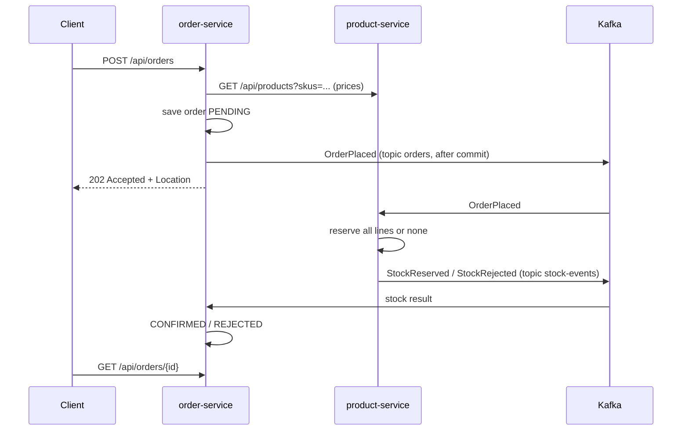

# shop-backend

Order checkout for an online shop, split into two Spring Boot services. `order-service` takes orders and
tracks their status. `product-service` owns products, prices and stock, and reserves stock for orders. Each
service has its own database and never reads the other one's tables. They talk over HTTP for one read-only
call and over Kafka for everything that changes state.

## How it works



1. `POST /api/orders` is validated (at least one line, quantity > 0).
2. order-service asks product-service for prices of all SKUs in one call. Unknown or inactive SKUs give `422`
   with the list of them.
3. The order is saved as `PENDING` with the prices fixed at that moment, and `OrderPlaced` is sent once the
   transaction has committed. The client gets `202` because the order is accepted but not confirmed yet.
4. product-service reserves stock for every line in one transaction and answers with `StockReserved` or
   `StockRejected` (with the SKUs that ran out).
5. order-service moves the order to `CONFIRMED` or `REJECTED`.

## Design decisions

### HTTP only for reading prices, Kafka for changing state

The price is needed to create the order at all, and reading is safe to repeat, so it is a synchronous call.
Reserving stock changes another service's data, so it goes through Kafka: the order is accepted even if
product-service is down, and the reservation happens when it comes back. Checking stock over HTTP and then
reserving would not help anyway, because stock can run out between the check and the write.

### Reservation is one conditional UPDATE per line

`UPDATE stock SET available = available - :qty WHERE sku = :sku AND available >= :qty` checks and writes in
one statement, so two orders cannot both take the last unit (there is a test with two concurrent orders for
one item). If any line fails, the whole transaction rolls back, then the rejection is stored in a separate
short transaction. Lines are processed in SKU order so two orders with the same products always lock rows in
the same order and cannot deadlock. `CHECK (available >= 0)` on the table is the last line of defence.

### OrderPlaced is sent after commit

Sending inside the transaction could reserve stock for an order that is rolled back afterwards.
`KafkaOrderEvents` publishes a Spring event inside the transaction and a `@TransactionalEventListener` sends
it to Kafka after commit. The price lookup runs outside the transaction, so a slow catalog with retries does
not hold a database connection.

### Topics, keys and partitions

`orders` and `stock-events` have 3 partitions each and are keyed by `orderId`, so all events of one order land
in the same partition and are handled in order, while different orders are handled in parallel. The service
that writes a topic creates it with a `NewTopic` bean; auto-creation is off in the broker so a typo in a topic
name fails instead of creating a new topic.

### Events are plain JSON without type headers

Every event has `eventId`, `eventType`, `occurredAt` and its data. Each service has its own event records and
there is no shared library. Type headers are off, so renaming a class in one service does not break the other;
the consumer knows what to read from the topic.

### Producer: `acks=all` and idempotence

Both are Kafka defaults now, they are set explicitly to show the choice. A write is confirmed only when all
in-sync replicas have it, and a retried send does not create a duplicate.

### At-least-once plus idempotent handlers instead of exactly-once

Offsets are committed after a record is processed (`ack-mode: record`), so after a crash a record is read
again. Kafka transactions would not help because the handlers also write to Postgres. Instead the handlers are
safe to repeat: product-service stores each reservation by `orderId` and on a duplicate `OrderPlaced` sends
the stored result again without touching stock; order-service changes status only from `PENDING`, so a
repeated or late result is ignored.

### Errors in consumers

Three kinds:
- business outcome, not an error: not enough stock is a normal `StockRejected`;
- temporary error, for example the database is down: 4 retries with exponential backoff (1, 2, 4, 4 s, about
  11 s in total), then the DLT;
- permanent error, such as broken JSON or an unknown SKU: straight to the DLT, retrying cannot help.

`DefaultErrorHandler` with `DeadLetterPublishingRecoverer` writes to `orders-dlt` / `stock-events-dlt` (same
partition as the original) with headers for the exception, original topic, partition and offset, and logs a
warning. Retries are blocking: the partition waits, but order is kept. Retry topics would not block but would
lose the order, see [docs/kafka.md](docs/kafka.md).

### Resilience4j on the price call

Each layer covers one problem:

| Layer | Settings | What it is for |
|---|---|---|
| HTTP client timeouts | connect 1 s, read 2 s | a hanging catalog does not hold our thread forever |
| Retry | 3 attempts, 200 ms × 2 with jitter, only network errors and 5xx | short blips such as a restart; 4xx will not change on retry |
| Circuit breaker | window of 20 calls, at least 10, opens at 50% failures or slow calls (> 1.5 s), 10 s open, 3 trial calls | when the catalog is down, answer at once instead of waiting for timeouts |
| Bulkhead | 20 concurrent calls, no waiting | a slow catalog cannot take all request threads |
| Rate limiter | 50 orders per second on `POST /api/orders` → `429` | a burst does not overload us and the catalog |

The aspects wrap in Spring Boot's default order: Retry → CircuitBreaker → Bulkhead → call. Every retry attempt
counts in the circuit breaker statistics, and a call rejected by an open circuit is not retried. The fallback
sits on the retry, the outermost layer, and turns the final error into `503` with `Retry-After: 10`. An order
without a known price is not accepted. TimeLimiter is not used: it is for async calls, and the HTTP client
timeouts do the job here.

### Code layout

Packages by feature, layers inside, with light ports where it helps testing: `ProductCatalog` and
`OrderEvents` are interfaces in `domain`, so `PlaceOrderService` is tested without HTTP and Kafka. Status
transitions live in `Order` itself (`confirm()` / `reject()` only from `PENDING`).

## Failure handling

| What happens | Result |
|---|---|
| product-service is down | 3 attempts per request, then `503`; after enough failures the circuit opens and `503` comes back in a few ms (4 ms in the demo) until a trial call succeeds |
| product-service is slow | read timeout after 2 s, counted as a failure; bulkhead keeps other endpoints free |
| not enough stock | `StockRejected`, order `REJECTED`, stock unchanged |
| broken event in a topic | straight to the DLT with the cause, the next records are processed |
| product-service database is down | retries for about 11 s, then the DLT |
| the same event arrives twice | no second reservation, the stored result is sent again; order status is not affected |
| a second product-service instance starts | rebalance, partitions are split between the instances |

## Limitations

- Saving to the database and sending to Kafka are two separate steps. If order-service dies right after the
  commit and before the send, the event is lost and the order stays `PENDING` forever. The same can happen to
  a stock result in product-service. A failed send is only logged. The proper fix is a transactional outbox.
- Nothing cancels an order or releases stock, and nothing times out a `PENDING` order.
- The rate limit is per instance. A global limit belongs in an API gateway.
- Records in the DLTs are only stored; there is no tool to replay them.
- Kafka runs as a single broker with replication factor 1, and both databases live in one Postgres container.
  Fine for local runs only.

## Running it

Needs Java 21 and Docker.

```bash
docker compose up -d                 # Kafka on 9092, Postgres on 5433 (databases orders and products)
./mvnw -q -DskipTests package
java -jar product-service/target/product-service-0.0.1-SNAPSHOT.jar   # port 8082
java -jar order-service/target/order-service-0.0.1-SNAPSHOT.jar       # port 8081
```

The database password defaults to `shop` for local runs. To change it, copy `.env.example` to `.env`. Demo
products (from the Flyway migration): `MOUSE-1`, `KBD-1`, `MON-27` (only 5 in stock), `HDMI-2M`, and
`CAM-720`, which is inactive.

```bash
curl -i -X POST localhost:8081/api/orders -H 'Content-Type: application/json' \
  -d '{"items":[{"sku":"MOUSE-1","quantity":2}]}'
curl localhost:8081/api/orders/<id>               # PENDING, then CONFIRMED
curl localhost:8081/actuator/circuitbreakers      # circuit breaker state
```

More requests are in [http/](http) for the IntelliJ HTTP client.

Tests use Testcontainers, so Docker has to be running: `./mvnw verify`.
